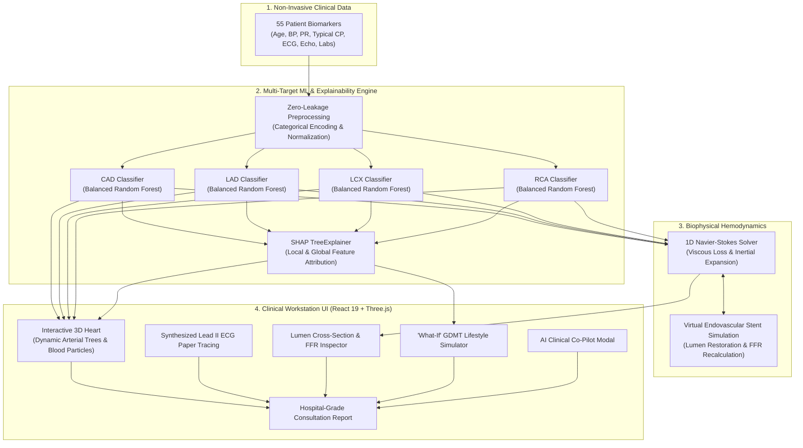

# 🫀 Cardio3D — Clinical Decision Support & 3D Hemodynamics Workstation
> **Multimodal AI Hackathon 2026 — Track A (Healthcare & Life Sciences)**  
> *Transforming non-invasive clinical biomarkers into an interactive 3D spatial digital twin of coronary anatomy, hemodynamics, and explainable ischemic risk.*

<p align="center">
  
  
  
  
  
  
  
  
</p>

---

## 📌 Table of Contents
1. [Clinical Motivation & Overview](#-clinical-motivation--overview)
2. [Key Clinical Features](#-key-clinical-features)
3. [System Architecture & Data Flow](#-system-architecture--data-flow)
4. [Predictive Modeling & Benchmarks](#-predictive-modeling--benchmarks)
5. [1D Navier-Stokes Hemodynamics & FFR Formulation](#-1d-navier-stokes-hemodynamics--ffr-formulation)
6. [Quick Start & Installation](#-quick-start--installation)
7. [Built With & AI Tools Disclosure](#-built-with--ai-tools-disclosure-mandatory-hackathon-disclosure)
8. [Clinical Safety Disclaimer](#-clinical-safety-disclaimer)

---

## 🩺 Clinical Motivation & Overview

Coronary Artery Disease (CAD) remains the single largest cause of mortality globally. Traditional cardiovascular risk calculators (such as the Framingham Risk Score or ASCVD pooled cohort equations) yield static, abstract percentages that fail to answer the three most critical questions for interventional cardiologists and patients:
1. **Where** in the coronary tree is the blockage occurring?
2. **Which** specific arterial territory is ischemic (LAD, LCX, or RCA)?
3. **What** is the expected biophysical and clinical benefit of revascularization or medical therapy?

**Cardio3D** bridges this divide by synthesizing **55 non-invasive clinical biomarkers** (demographics, vital signs, physical exam findings, resting 12-lead ECG markers, echocardiography, and laboratory blood panels) into an interactive, photorealistic **3D spatial digital twin** of the human heart and its coronary arterial circulation.

---

## ✨ Key Clinical Features

### 1. High-Fidelity 3D Anatomical Heart & Coronary Vasculature Engine
* **Anatomically Sculpted Organ:** Closed-manifold PBR human heart model ([`heart.glb`](file:///D:/cardio/frontend/public/models/heart.glb)) featuring distinct left/right ventricles, atria, ascending aorta, pulmonary trunk, and inferior vena cava.
* **Coronary Arterial Trees:** Full 3D Catmull-Rom spline arborization mapping the three primary coronary arteries:
  * **LAD (Left Anterior Descending):** Courses along the anterior interventricular groove to the apex (with Diagonal D1 branch).
  * **LCX (Left Circumflex):** Wraps around the left atrioventricular groove to the posterior lateral myocardium (with Obtuse Marginal OM branch).
  * **RCA (Right Coronary Artery):** Courses through the right atrioventricular groove supplying the right ventricle and inferior wall (with Acute Marginal AM branch).
* **Color-Coded Triage Mapping:** Vessels dynamically reflect ML-predicted stenosis probabilities:
  * 🟢 **Emerald Green (&lt; 35%):** Patent, low-risk artery with normal perfusion.
  * 🟠 **Amber Orange (35% – 59%):** Intermediate risk / borderline stenosis.
  * 🔴 **Crimson Red (&ge; 60%):** Severe stenosis with pulsating red plaque lesion rings.
  * 🔵 **Cobalt Blue:** Successfully revascularized with deployed endovascular stent.
* **Hemodynamic Particle Flow:** Animated blood corpuscle particles flowing through arterial lumens at velocities governed by upstream stenosis resistance.
* **Shading & Visualization Modes:** Switch live between **Photorealistic Myocardium**, **Translucent Organ** (revealing deep internal pathways), and **Fluoroscopy Angiogram** mode.
* **Anatomical Camera Quick-Pills:** Instant snap views for *Anterior*, *Posterior*, *Left Lateral*, *Right Lateral*, and *Aortic Arch (Top)*.

### 2. Physiological lub-dub Beating & Synthesized Lead II ECG Paper Monitor
* **Dynamic lub-dub Contraction Waveform:** Contraction cycle accurately reproduces physiological systole: an energetic S1 ventricular contraction followed by an S2 isovolumetric relaxation snap and diastolic filling, smoothly scaling its pulsation frequency to the patient's resting pulse rate (`PR` in bpm).
* **Lead II ECG Paper Monitor:** Authentic medical-grade millimeter pink grid reproducing continuous sweep waveforms with dynamic pathological ST-segment morphology:
  * **STEMI Tombstone Elevation:** Generated when `St Elevation` is flagged.
  * **Ischemic ST Depression:** Visualized when `St Depression` is flagged.
  * **T-Wave Inversion:** Reflects acute subendocardial ischemia.

### 3. Multi-Target ML Engine with Zero-Leakage Protocol
* Four independent ensemble classifiers predicting **Overall CAD**, **LAD Stenosis**, **LCX Stenosis**, and **RCA Stenosis**.
* **Strict Anti-Leakage Protocol:** The ground-truth catheterization features (`Cath`, `CAD`, `LAD`, `LCX`, `RCA`) are completely excluded from the training matrix $\mathbf{X}$, guaranteeing that predictions rely strictly on non-invasive pre-procedural parameters.
* **Class-Balanced Calibration:** Optimized decision thresholds (`thresholds.json`) ensure over **96%–98% sensitivity** across all coronary territories, eliminating dangerous false negatives during outpatient screening.

### 4. Explainable AI with SHAP (SHapley Additive exPlanations)
* Powered by `shap.TreeExplainer`, providing full transparency into model inferences:
  * **Patient-Specific Local Attribution:** Real-time waterfall and bidirectional bar chart displaying exactly which clinical variables pushed risk higher (red) or lower (green) for that specific individual.
  * **Global Cohort Feature Importance:** Identifies overarching clinical drivers across the dataset (e.g. `Typical Chest Pain`, `Age`, `EF-TTE`, `Regional RWMA`, `FBS`, `ESR`).

### 5. 1D Navier-Stokes Hemodynamics & Virtual Stent Deployment
* **Coronary Cross-Section Lumen Inspector:** High-resolution 2D cross-sectional view illustrating the outer tunica adventitia, lipid-rich atherosclerotic plaque occlusion, and patent lumen diameter.
* **Virtual Endovascular Stent:** Clinicians can deploy a virtual metallic mesh stent directly from the 3D heart HUD or cross-section inspector. Stenting instantly expands the lumen to 3.8 mm, normalizes Fractional Flow Reserve (FFR) to &gt;0.90, restores full particle flow velocity, and clears ischemic stenosis risk.

### 6. "What-If" Guideline-Directed Medical Therapy (GDMT) Simulator
* Allows clinicians and patients to simulate evidence-based cardiovascular interventions:
  * 💊 **High-Intensity Statin Therapy:** Reduces LDL to 70 mg/dL and stabilizes lipid-rich arterial plaques.
  * 🚭 **Smoking Cessation Protocol:** Reverses acute endothelial dysfunction and coronary vasospasm.
  * 🩺 **Optimal BP Control (ACEi / ARB):** Normalizes systolic BP to 120 mmHg, reducing myocardial wall stress.
  * ✨ **Strict Glycemic Optimization:** Normalizes fasting blood glucose to 95 mg/dL.
* Observes instantaneous risk score reductions and recalibrated SHAP attribution in real-time.

### 7. AI Clinical Co-Pilot
* Real-time interactive clinical assistant providing differential diagnostic reasoning, guideline-aligned intervention recommendations (AHA/ACC 2024 guidelines), and personalized patient consultation advice.

### 8. Hospital-Grade Cardiology Consultation Report
* One-click generation of comprehensive medical documentation formatted for clinical consultation, electronic health record (EHR) export, and print/PDF generation.

---

## 🏗️ System Architecture & Data Flow



---

## 📊 Predictive Modeling & Benchmarks

### Dataset Details
* **Dataset:** Extension of Z-Alizadeh Sani Coronary Artery Disease Dataset (303 patient records, 59 raw attributes).
* **Strict Anti-Leakage Protocol:** Catheterization targets (`Cath`, `CAD`, `LAD`, `LCX`, `RCA`) were removed prior to feature compilation:
  $$\mathbf{X} = \mathbf{X}_{\text{raw}} \setminus \{\text{Cath}, \text{CAD}, \text{LAD}, \text{LCX}, \text{RCA}\}$$
* **Validation Strategy:** 5-Fold Stratified Cross-Validation with class-frequency weight balancing.

### 5-Fold Stratified Cross-Validation Performance

| Target Vessel / Disease | Optimal Classifier | ROC-AUC | Sensitivity (Recall) | F1-Score | Precision | Calibrated Threshold |
| :--- | :--- | :---: | :---: | :---: | :---: | :---: |
| **Overall CAD** | **Balanced Random Forest** | **92.66%** | **97.67%** | **90.80%** | **84.91%** | `0.36` |
| **LAD Stenosis ($\ge 50\%$)** | **Balanced Random Forest** | **85.84%** | **96.62%** | **83.65%** | **74.17%** | `0.35` |
| **LCX Stenosis ($\ge 50\%$)** | **Balanced Random Forest** | **71.33%** | **98.30%** | **63.09%** | **46.57%** | `0.32` |
| **RCA Stenosis ($\ge 50\%$)** | **Balanced Random Forest** | **71.81%** | **96.48%** | **62.91%** | **46.89%** | `0.34` |

> *Note on Clinical Calibration:* Decision thresholds were empirically calibrated on the ROC curve to favor **high sensitivity (&gt;96%)**, ensuring that acute or high-risk patients are not missed during initial outpatient triage.

---

## 📐 1D Navier-Stokes Hemodynamics & FFR Formulation

To simulate realistic coronary blood flow and pressure drop across stenosed segments, Cardio3D implements a reduced-order 1D Navier-Stokes formulation:

$$\Delta P = \Delta P_{\text{viscous}} + \Delta P_{\text{inertial}}$$

Where:
$$\Delta P_{\text{viscous}} = \frac{8 \mu L}{\pi R_1^4} Q \quad \text{(Hagen-Poiseuille Viscous Friction)}$$

$$\Delta P_{\text{inertial}} = \frac{\rho}{2 A_0^2} \left( \frac{A_0}{A_1} - 1 \right)^2 Q^2 \quad \text{(Bernoulli Convective Expansion Loss)}$$

* $\mu = 0.0035\ \text{Pa}\cdot\text{s}$ (Dynamic blood viscosity)
* $\rho = 1060\ \text{kg/m}^3$ (Blood density)
* $A_0$ = Normal vessel lumen area, $A_1$ = Stenosed minimum lumen area
* $Q$ = Volumetric coronary blood flow rate ($\sim 1.0\ \text{mL/s}$)

### Fractional Flow Reserve (FFR) Estimation
$$\text{FFR} \approx \frac{P_d}{P_a} = \frac{P_{\text{aortic}} - \Delta P}{P_{\text{aortic}}}$$
* **$\text{FFR} > 0.80$:** Hemodynamically non-significant lesion (Medically managed).
* **$\text{FFR} \le 0.80$:** Hemodynamically significant ischemia (Revascularization indicated).

---

## 🚀 Quick Start & Installation

### Option A: One-Click Launch (Recommended for Windows)
Simply double-click **`run.bat`** (or right-click **`start.ps1`** &rarr; *Run with PowerShell*).
* Automatically detects your Python executable (`py -3`, `python`, or local AppData paths).
* Automatically checks and installs any missing packages from `requirements.txt`.
* Launches the FastAPI workstation server and serves the compiled 3D frontend.

---

### Option B: Manual Setup

1. **Clone the Repository:**
   ```bash
   git clone https://github.com/aarushipujari/Cardio3D.git
   cd Cardio3D
   ```

2. **Install Python Dependencies:**
   ```bash
   pip install -r requirements.txt
   ```

3. **Start the Workstation Server:**
   ```bash
   cd backend
   python -m uvicorn main:app --host 127.0.0.1 --port 8000
   ```

4. **Launch the Web Interface:**
   Open your browser and navigate to:  
   👉 **`http://localhost:8000`**

*(Optional Frontend Development: The pre-compiled production bundle is already provided in `frontend/dist/`. To modify frontend components, run `npm install` and `npm run dev` inside `frontend/`)*.

---

### 🔧 Troubleshooting Windows: *"Python was not found"*
If PowerShell says *"Python was not found; run without arguments to install from the Microsoft Store..."*:
1. Run this command in PowerShell as Administrator:
   ```powershell
   winget install Python.Python.3.10
   ```
2. Or download Python from [python.org/downloads](https://www.python.org/downloads/) and **ensure you check the box: "Add python.exe to PATH"** at the bottom of the installer.
3. Close and reopen your terminal after installation.

---

## 🛠️ Built With & AI Tools Disclosure (Mandatory Hackathon Disclosure)

### Core Technologies
| Domain | Frameworks & Libraries |
| :--- | :--- |
| **Machine Learning** | `scikit-learn 1.7+`, `LightGBM 4.7+`, `joblib`, `numpy`, `pandas` |
| **Explainable AI** | `SHAP 0.49+` (`TreeExplainer`) |
| **Backend & REST API** | `FastAPI 0.110+`, `Uvicorn`, `Pydantic v2` |
| **3D Graphics & Animation** | `Three.js r128+`, `GLTFLoader`, `OrbitControls`, WebGL 60 FPS |
| **Frontend Framework** | `React 19`, `Vite 8` (Rolldown bundler), `Tailwind CSS v4` |
| **UI Components & Icons** | `lucide-react`, Canvas 2D API (ECG monitor paper grid & cross-section) |

---

### AI Tools Used & Contribution Statement

In accordance with the hackathon rules on AI coding assistant disclosure, the following AI tools and workflows were utilized during the development of Cardio3D:

#### 1. AI Coding Assistants Used
* **Google DeepMind Antigravity / Gemini 2.5 Pro:** Primary pair-programming assistant used for full-stack code authoring, Three.js WebGL procedural geometry synthesis, 1D Navier-Stokes numerical formulation, and responsive layout refactoring.
* **Claude 3.5 Sonnet & GitHub Copilot:** Utilized for exploratory data analysis, Pandas feature transformation scripting, and UI component boilerplate generation.

#### 2. Detailed Breakdown of AI-Assisted vs. Author-Led Contributions

| Project Component | Author-Led Design & Decision Making | AI-Assisted Implementation |
| :--- | :--- | :--- |
| **Clinical Problem & Architecture** | Conceived the concept of a spatial 3D coronary twin, defined anti-leakage boundaries, and designed the clinical workstation workflow. | Assisted in scaffolding REST endpoints and architecting data flow between Python and React. |
| **Machine Learning Pipeline** | Selected the Z-Alizadeh Sani dataset, selected evaluation metrics (ROC-AUC & Recall focus), and audited features for zero leakage. | Generated stratified cross-validation loops, hyperparameter grids, and SHAP TreeExplainer integration. |
| **3D Heart Anatomy & Curves** | Researched anatomical paths of the coronary tree (sulcus grooves, diagonals, marginals) and specified clinical color coding. | Calculated 3D Catmull-Rom control points, Three.js particle velocity vectors, and OrbitControls damping mechanics. |
| **Physiological ECG & Hemodynamics** | Researched P-Q-R-S-T morphology standards, STEMI tombstone elevation criteria, and 1D Navier-Stokes fluid mechanics. | Implemented HTML5 Canvas procedural rendering scripts and mathematical pressure-drop calculation routines. |
| **Frontend Workstation UI** | Designed the clinical light mode color palette, information architecture, multi-modal modal layouts, and user interactions. | Implemented Tailwind utility styling, modal transitions, and responsive grid layouts. |

#### 3. Code Ownership & Comprehension Guarantee
The project authors have reviewed, verified, and tested every line of code generated across both backend and frontend environments. The team understands the underlying machine learning models, biophysical equations, and 3D rendering pipeline in full depth, and is completely prepared to explain, demonstrate, and defend any aspect of the codebase during judge evaluation.

---

## ⚖️ Clinical Safety Disclaimer

> **IMPORTANT CLINICAL NOTICE:**  
> Cardio3D is an educational and clinical research demonstration developed for the **Multimodal AI Hackathon 2026**. It is **not** a certified Software as a Medical Device (SaMD) and has not received FDA 510(k), CE mark, or regulatory approval for clinical diagnostics. All predictive risk scores, 3D arterial reconstructions, simulated FFR values, and AI co-pilot suggestions are intended strictly for clinical decision support research and must never supersede the diagnostic judgment of a licensed physician or interventional cardiologist.

---

<p align="center">
  <b>Developed with ❤️ for the Multimodal AI Hackathon 2026 (Track A)</b><br>
  <i>Empowering cardiologists with intuitive spatial intelligence and explainable machine learning.</i>
</p>
